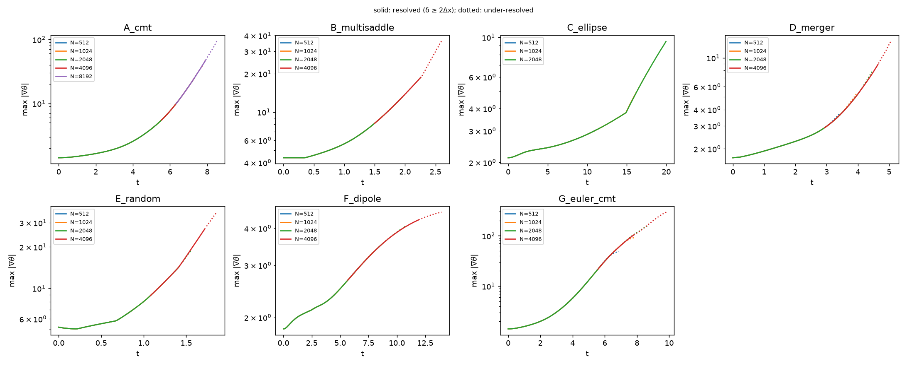
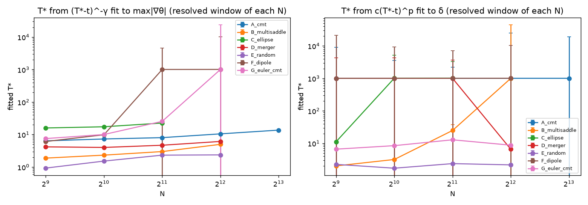

**Research question:** Oriphim held-out test set. **Computation, analysis and drafting:** Ori (Oriphim), with an independent review.

## Abstract

We ask whether the inviscid surface quasi-geostrophic (SQG) equation on a periodic square shows a numerical sign of finite-time singularity. We integrate it with a dealiased pseudo-spectral method at grid sizes from 512² up to 8192², for the classic Constantin–Majda–Tabak (CMT) saddle and five other families of smooth initial data. 2D Euler is run as a regular control. For each run we fit three growth laws to the maximum temperature gradient: exponential, double exponential, and a power-law singularity $A(T^*-t)^{-\gamma}$. We also fit two decay laws to the analyticity-strip width $\delta(t)$. The CMT data stay resolved to $t \approx$ 7.9, where $\max|\nabla\theta| \approx$ 46.5. For CMT the finite-time law never beats the (double-)exponential laws, and for no family is it clearly best on the two finest grids that the verdict uses. For CMT, the singular time it fits moves later as the fit window extends; on the two finest grids it is 10.5 (4096²) and 13.7 (8192²), well beyond the windows' ends. Under a verdict rule fixed before the main run, four families read "no blow-up indicated", two read "inconclusive", and none reads "blow-up indicated". The two inconclusive verdicts come from the strip-width test, which also fires on regular 2D Euler. This is a numerical indication over finite time windows, not a proof.

## 1. The question and why it matters

SQG describes a temperature-like scalar $\theta$ carried along by a velocity that $\theta$ itself induces:
$\partial_t\theta + u\cdot\nabla\theta = 0$, with $u = \nabla^\perp(-\Delta)^{-1/2}\theta$.
It is used in models of the atmosphere and ocean. Mathematically it is a 2D cousin of 3D Euler: in both, gradients of the carried quantity can be stretched without bound. Whether smooth SQG solutions stay smooth for all time is an open problem. Its 3D Euler counterpart is a similar open problem. In 1994 Constantin, Majda and Tabak suggested from simulations that a front collapses near $t\approx 8$ for their saddle data. Ohkitani & Yamada (1997) suggested double-exponential growth instead; Constantin, Nie & Schörghofer (1998) found no blow-up; Córdoba (1998) proved that the simple hyperbolic-saddle collapse cannot happen; and Constantin et al. (2012), at higher resolution, saw no blow-up up to later times. Simulations cannot settle the question. They can say whether the data, while resolved, look like a singularity with a fixed time $T^*$. That is the question here.

## 2. Method in brief

- **Solver.** Pseudo-spectral on $[0,2\pi)^2$ with real FFTs, double precision, the 2/3 dealiasing rule, and classical RK4 with CFL number 0.4. No viscosity or filter; RK4 at this step size damps the fastest near-cut-off modes slightly (about 1.6% per step), which a half-step run shows to be harmless for CMT while resolved. Replacing $|k|$ by $|k|^2$ in the stream-function inversion gives 2D Euler, which is known to be regular; we use it as the control (G).
- **Initial data.** (A) CMT, $\theta_0=\sin x\sin y+\cos y$; (B) a multi-mode saddle; (C) an elliptical vortex; (D) a merging vortex pair; (E) a random smooth field (one seed); (F) a dipole. All are analytic.
- **Grids.** 512², 1024² and 2048² run from $t=0$. 4096² and 8192² (8192² for CMT only) continue from the coarser run by zero-padding in Fourier space, once the coarser run's energy at its cut-off is below $10^{-20}$ of the peak shell (about $10^{-10}$ in amplitude). This was the scale-down agreed in the plan.
- **Diagnostics.** We track the maximum gradient $G=\max|\nabla\theta|$, refined below grid scale by spectral interpolation. The strip width $\delta(t)$ is the length scale of the smallest structures. It comes from fitting $\log E(k)=a-n\log k-2\delta k$ to the shell spectrum. A run counts as resolved while $\delta\ge 2\Delta x$.
- **Fits and verdict.** We fit exponential, double-exponential and finite-time laws to $\log G$, and exponential decay or power-law collapse to $\delta$. Models are compared by AIC. The verdict rule was fixed before the main run (PLAN.md). "Blow-up indicated" requires a $\delta$ collapse, a finite-time gradient law better by more than 2 in AIC, and $T^*$ agreeing across the two finest grids.

## 3. Results



**The gradient grows fast but shows no fixed singular time.** For CMT, $G$ grows faster than exponentially. The double exponential has the best AIC at every grid. Grids agree on $G$ to within 4e-04 (relative) while the coarser grid is resolved. So the finer grids mostly extend the time window rather than change the curve. The singular time fitted on each grid's window moves later as that window extends:

| grid N | 512 | 1024 | 2048 | 4096 | 8192 |
|---|---|---|---|---|---|
| resolved until t | 5.2 | 5.9 | 6.6 | 7.3 | 7.9 |
| fitted $T^*$ | Fig. 2 / summary.md | Fig. 2 / summary.md | Fig. 2 / summary.md | 10.5 | 13.7 |

If there were a real singularity at a fixed time, later windows would pin $T^*$ down, not push it away. On the three coarser grids the fitted $T^*$ also rises with the window end (Fig. 2, left, on a log axis; exact values in `results/summary.md`). The 4096² and 8192² values come from shorter, later windows clipped at the hand-off, so part of the jump from the 2048² value is the change of window, and their error bars are lower bounds. The strip width of the CMT run decays exponentially in every main window, at a rate that steepens slowly (`results/summary.md`). This drift is with the end of the window, not with resolution.



**Verdicts under the pre-registered rule.**

| family | finest grid resolved until t | $\max\lvert\nabla\theta\rvert$ there (vorticity gradient for Euler) | verdict |
|---|---|---|---|
| A CMT (8192²) | 7.9 | 46.5 | no blow-up indicated |
| B multi-mode saddle (4096²) | 2.3 | 18.8 | no blow-up indicated |
| C elliptical vortex (2048²) | 19.9 | 9.4 | no blow-up indicated |
| D vortex merger (4096²) | 4.6 | 8.9 | inconclusive |
| E random field (4096²) | 1.7 | 27.1 | inconclusive (not robust) |
| F dipole (4096²) | 11.9 | 4.3 | no blow-up indicated |
| Euler control (4096²) | 7.8 | 102.3 | inconclusive |

On the two finest grids of every family, which the verdict uses, the finite-time gradient law is never clearly best. On some coarser grids (C, D, F) it does fit best, but the singular time it predicts lies inside a time range that a finer grid later resolved without blow-up (values in `results/summary.md`). For E it fits best only at 1024² for late window starts, with a singular time just past the end of E's finest resolved window, so no finer grid has tested it (see Sec. 5). D and E are "inconclusive" only because their strip width fits better to a collapse at 4096² ($T^*\approx$ 6.6 for D and 2.2 for E). The Euler control, which cannot blow up, gives the same kind of collapse ($T^*\approx$ 8.8 at 4096²). So this test has no power to tell regular from singular flow, and the inconclusive verdicts are not a sign of blow-up.

## 4. How it was checked

- **Code and time stepping.** The truncated system conserves the $L^2$ norm and the Hamiltonian exactly. Their drift stays at round-off level: at most 2e-12 for CMT at 8192² while resolved. This tests the code, not the spatial resolution. Halving the time step changes $G$ by at most 2e-13 (CMT, 2048²). Initial maxima match closed forms. Thirteen unit tests pass, among them steady states, RK4 order and recovery of fits on synthetic data.
- **Pass/fail checks set in advance.** Before the main run an independent reviewer (the Sceptic) wrote the checks in `tests/checks/`. The final state is 245 passed and 4 failed. All four failures are for family E: in three, its coarse- and fine-grid strip widths disagree by 17–35%; in the fourth, its verdict is not robust (below).
- **What the Sceptic flagged and what changed.** The Sceptic reviewed the results three times. (1) Right after each continuation hand-off, the strip width was 8–118% too high while the new high-wavenumber shells filled in. The analysis now drops these points, plus a 0.2 time-unit settling period. This settling value was chosen *after* seeing results. It is disclosed as post hoc. It moved D and E from "no blow-up indicated" to "inconclusive" and changed no other verdict. (2) The fit error bars are covariance standard errors on serially correlated residuals, and they are far too small. A "total" error that includes the spread over fit-window starts was added. It is degenerate for the 4096²/8192² windows, so every ± is a lower bound. (3) A composite fit of the strip width across grids was driven by the seams between grids and is withdrawn. (4) The Sceptic rewrote one check after results existed, keeping its original intent. LIMITS.md records this. No code, unit or sign error was found.

## 5. What this does not show

- It is not a proof either way. Nothing is claimed past each family's resolved window. CMT is resolved only to $t\approx 7.9$, at the edge of the region where a singularity was once proposed.
- The strip-width test is the weakest diagnostic. It depends on which shells are fitted, it is biased by 5–37% near $2\Delta x$, and it gives a false positive on regular Euler. The SQG verdicts therefore rest in practice on the gradient fits, while the choice between "no blow-up indicated" and "inconclusive" is set by this non-robust test: with a stricter $\delta\ge 4\Delta x$ threshold, CMT itself would read "inconclusive" ($T^*\approx 9$). None of these choices yields "blow-up indicated".
- The drift of $T^*$ follows the end of the fit window, not the grid size. "Best AIC" ranks three curves; it does not identify a mechanism. The double-exponential parameters drift too.
- Family E's verdict flips to "no blow-up indicated" when 0.2 more time units after the hand-off are dropped, because no 4096² strip-width fit is then left. Its top-grid fit has only 13 points that cannot be checked against a coarser grid, and there is one random seed. Unlike CMT, E's gradient-fitted $T^*$ does not move later: 2.33 at 2048² and 2.37 at 4096², under a time unit past its resolved window.
- The initial data were our choice. Family B's attribution to Constantin et al. (2012) is unverified. There is no 8192² run for Euler or the non-CMT families. Only one dealiasing rule was used, there is no physical dissipation (only the slight RK4 damping near the cut-off, checked only for CMT), and the domain is periodic.

## 6. Reproducing it

```
uv venv .venv && uv pip install --python .venv/bin/python numpy scipy matplotlib numexpr pytest
.venv/bin/python -m pytest tests/test_solver.py   # unit tests
.venv/bin/python run.py --nmax 512                # quick version (~15 min)
.venv/bin/python run.py                           # full campaign (~14 h, ~8 GB RAM for 8192²)
.venv/bin/python run.py --analyze-only            # refit from results/runs/*.npz
.venv/bin/python -m pytest tests/checks -q        # the Sceptic's checks
```

All numbers are in `results/summary.json` and `results/summary.md`. The plan and the verdict rule are in `PLAN.md`, the full caveats in `LIMITS.md`, and the reviews in `notes/review.md`.
